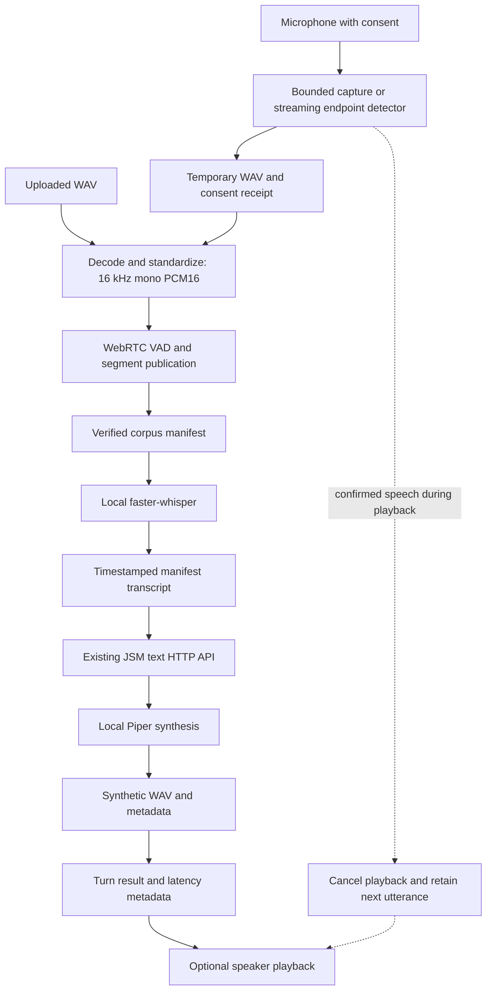

# JSM Voice MVP architecture review

Reviewed on 2026-10-07 against implementation commit `0938e3d`. This is prompt 16's read-only review: application code was not changed during the review. The separate native audio-token project has not been started.

The modular pipeline works locally from WAV or microphone input through Arabic ASR, the existing JSM text server, and synthetic speech playback. It is suitable for development by one trusted operator. It is not ready for multiple users or deployment: the current tiny JSM checkpoint produces incoherent responses, retention expiry is not enforced, concurrent metadata writes are uncoordinated, and barge-in has no acoustic echo cancellation.

## Repository tree

Files below are grouped within their actual directories. Every Python package directory also contains `__init__.py`. Runtime directories are shown separately because their contents are ignored by Git.

```text
jsm-voice/
  .gitignore, .gitkeep, README.md
  requirements.txt, requirements-dev.txt
  configs/
    voice.json, audio.json, vad.json, asr.json, llm.json
    tts.json, devices.json, streaming.json, privacy.json
  docs/
    architecture-review.md
  scripts/
    inspect_audio.py, standardize_audio.py, segment_audio.py
    build_voice_manifest.py, transcribe_audio.py, respond_audio.py
    download_asr_model.py, download_tts_model.py, synthesize_audio.py
    voice_turn.py, voice_chat.py, detect_utterance.py
  src/
    paths.py, config.py, artifacts.py, timing.py
    logging_config.py, cancellation.py, privacy.py
    audio/
      config.py, models.py, inspection.py
      wav_reader.py, wav_writer.py, standardization.py
    vad/
      config.py, interface.py, models.py
      segmentation.py, service.py, artifacts.py
      backends/webrtc.py
    corpus/
      models.py, manifest.py
    asr/
      config.py, interface.py, models.py, service.py
      backends/faster_whisper.py
    llm/
      config.py, interface.py, models.py, jsm_adapter.py
    tts/
      config.py, interface.py, models.py, piper_backend.py
    devices/
      config.py, capture.py, chunks.py, playback.py
    streaming/
      config.py, models.py, vad.py, detector.py, capture.py
    application/
      models.py, voice_turn.py, voice_chat.py
      streaming_chat.py, interruption.py
  tests/
    test_audio_core.py, test_standardization.py, test_segmentation.py
    test_artifacts.py, test_manifest.py, test_asr.py, test_llm.py
    test_tts.py, test_voice_turn.py, test_devices.py
    test_observability.py, test_streaming.py, test_interruption.py
    test_config.py, test_privacy.py
  storage/uploads/.gitkeep

Local, ignored:
  .venv/
  storage/
    uploads/, recordings/, standardized/, segments/
    manifests/, generated/, turns/
  artifacts/
    models/asr/, models/tts/, huggingface/, logs/
```

The sibling `jsm_0.1` remains the owner of text tokenization, text model training, checkpoints, and the text inference server. JSM Voice does not import its generic `src` package.

## Request flow and audio flow



`VoiceTurnService` injects preprocessing, ASR, text generation, and TTS dependencies. The application owns their ordering; backend interfaces isolate model implementations. A failed stage stops downstream work. A successful file turn publishes a result only after all four processing stages complete.

The audio core decodes integer PCM WAVs into sample values. Standardization downmixes channels, resamples with a polyphase filter, and quantizes to PCM16. The original upload is preserved. VAD emits sample-indexed regions, and the artifact layer writes segment WAVs. Sample positions, with exclusive end positions, are authoritative; seconds are derived from the standardized sample rate. The final short VAD frame is handled without extending audio beyond its actual length.

ASR receives each verified 16 kHz mono segment and converts its samples to floating-point amplitudes. Whisper produces text and segment timestamps; the service adds each segment's offset to produce source-relative spans. The JSM BPE tokenizer operates on that text inside the existing server. Piper receives the text response and produces a separate WAV at its voice's native rate, currently 22,050 Hz. ASR timestamps are model estimates, not word-level forced alignment.

Streaming currently means incremental microphone capture and endpoint detection. ASR, text generation, and synthesis remain complete-utterance operations. With barge-in, playback runs in one worker while sustained microphone speech triggers cancellation and preserves the next utterance. Use headphones: loudspeaker echo can trigger the detector.

## Data ownership and locations

| Data | Default location | Lifecycle and limitations |
| --- | --- | --- |
| Original uploads | `storage/uploads/` | Preserved; processing does not overwrite or delete them. Consent and rights are unknown unless supplied. |
| Microphone sources | `storage/recordings/` | WAV plus `.recording.json` consent receipt. Full chat deletes the receipted source after processing by default, including processing failures. Diagnostic capture keeps its WAV. |
| Standardized audio | `storage/standardized/` | Source hash, format, and processing version identify the artifact. Existing output is verified before reuse. |
| Speech segments | `storage/segments/<source-id>/<run-id>/` | Segment WAVs and `segments.json`; segmentation identity includes settings and artifact identity. |
| ASR and corpus annotations | `storage/manifests/<source-id>/<run-id>.json` | Source/segment hashes, sample bounds, transcript spans, language, provenance, consent, retention, and optional speaker ID. Updated atomically. |
| Generated speech | `storage/generated/` | UUID WAV and JSON containing generated text, voice, model path, `synthetic: true`, and retention expiry. |
| Turn results | `storage/turns/` | Transcript, generated response, artifact references, and processing timings. Interactive runs add `.interaction.json`. |
| Operational events | `artifacts/logs/voice.jsonl` | Turn ID, component, duration, success, and exception type. Transcript content is omitted. |
| Model weights | `artifacts/models/` | Local Whisper and Piper weights. Download commands are explicit network operations. |

Git ignores these runtime files and weights; only the uploads placeholder is tracked. Git exclusion does not prevent OneDrive synchronization. Deleting a raw microphone WAV leaves derived audio, transcripts, and a historical source reference in its manifest. The receipt records deletion, but the manifest does not become a self-contained deletion ledger. Retention expiry is metadata rather than an automatic cleanup mechanism.

## Model and configuration lifecycle

The service factory loads Whisper and Piper once per service instance and reuses them across chat turns. A separate CLI invocation creates a new instance. Whisper uses local weights only during inference, selects CPU or configured CUDA, and can fall back to CPU after supported initialization or inference failures. Physical CUDA execution was not validated on this machine. Piper uses its configured local voice. No global per-turn model reload was found in JSM Voice.

The HTTP adapter delegates JSM model caching to the existing server. That server may reload when its checkpoint changes. A model filename alone therefore does not identify immutable behavior; release hashes/revisions for all three models should be recorded before reproducibility is claimed.

`configs/voice.json` composes typed component settings and runtime locations. Component references resolve relative to the bundle, and runtime paths resolve relative to the project root. The application validates canonical ASR format, separate output directories, and approved runtime roots before constructing the service. CLI overrides provide selected device, duration, and config choices. Settings are loaded for startup rather than hot-reloaded during a conversation. No credentials are required in the committed configuration.

Path checks protect normal configured workflows. They are not an OS sandbox: trusted low-level APIs accept explicit paths, and a local actor who can modify configs, receipts, symlinks, or model files remains outside the trust boundary.

## Error handling and publication

| Trigger | Behavior | Remaining limitation |
| --- | --- | --- |
| Corrupt, truncated, compressed, or unsupported WAV | Decoder rejects it before normal downstream processing. | No compressed-media ingestion; large valid inputs can consume substantial memory. |
| Conflicting existing derived artifact | Verification rejects reuse instead of silently overwriting it. | No repair command or artifact garbage collector. |
| No speech or empty transcript | Turn stops before requesting a response. | Noise and endpoint quality still need corpus evaluation. |
| Missing model or unavailable JSM server | Explicit failure; no fabricated response. | Native model calls do not have hard execution deadlines. |
| Invalid API response or empty continuation | Text adapter rejects the result. | API compatibility depends on the existing prompt-plus-continuation contract. |
| Capture overflow or playback underflow | Device layer reports failure and closes streams. | A stalled native driver call can still delay shutdown. |
| Cancellation or Ctrl+C | Playback checks between short blocks; orchestration checks between stages. | Running native ASR/TTS calls are not preempted. |
| Artifact write failure | Temporary files are cleaned up; publication is atomic at individual-file level. | A WAV can exist without its later JSON sidecar; the whole pipeline is not a filesystem transaction. |
| Privacy cleanup failure | Deletion refuses an unmatched receipt; errors remain visible. | Cleanup failure can mask an earlier processing error, and interrupted processes need recovery. |

Manifest replacement prevents partial JSON reads, but it does not provide locking or compare-and-swap. Concurrent annotation updates can overwrite each other. Metadata reading and hashing also use separate file accesses, so the implementation assumes artifacts are not maliciously changed between those operations. Immutable publication uses hard links; behavior was validated on this Windows filesystem, not every possible deployment volume.

## Latency evidence

`StageTimer` uses `perf_counter`; a context-local turn ID connects nested processing and device events. Failures also emit timed events. Nested measurements overlap: standardization and VAD are inside preprocessing, so summing every metric double-counts work.

One completed CPU run on the 4.807-second source recorded:

| Measurement | Milliseconds |
| --- | ---: |
| Standardization | 38.5 |
| VAD | 1.4 |
| Preprocessing, including artifact verification | 87.9 |
| ASR | 2440.0 |
| JSM text API | 451.3 |
| TTS | 1163.3 |
| Total processing | 4143.1 |

Evidence is the local, ignored `storage/turns/706ec6bb9d3644e0aa7e204f8b6816b0.json`. These are one machine's observed values, not a percentile benchmark or service-level promise. Processing total excludes initial model loading, final result publication, capture, and speaker playback. Backend load timings are separate from turn latency. Playback startup measures software stream startup, not acoustic time to first audible sound.

Interactive timing includes capture/playback. In barge-in mode it can also include waiting for the next utterance, which is then reused on the next loop iteration. It should not be compared directly with sequential turn latency without separating listening time and attributing capture to the appropriate turn.

## Validation and coverage

The final implementation suite passed **122 tests**. `pip check` reported no broken requirements, and the implementation diff passed whitespace validation. The documented test command is `python3 -m pytest` (or `python -m pytest` with this Windows environment active). In the restricted execution environment, the same suite was run with its temporary directory under the project's ignored runtime storage.

Tests cover PCM widths and channels, duration and corruption checks, standardization integrity and reuse, VAD boundaries and minimum-duration rules, artifact publication, manifest validation and annotation preservation, ASR/LLM/TTS contracts, pipeline order and failure propagation, timing correlation, configuration, consent and deletion, streaming endpoint transitions, and interruption cleanup. Fakes remain confined to tests. No numeric line/branch coverage percentage was measured.

Separate real checks exercised the supplied recording through standardization, segmentation, local Arabic ASR, the existing JSM API, and Piper WAV output. Hardware checks captured microphone samples, played audio, exercised endpoint detection, and cancelled active playback. The source recording hash remained unchanged. The tiny JSM response was incoherent; successful synthesis of it establishes integration only.

Not established: held-out Arabic/Saudi WER, perceptual TTS quality, human conversational success, echo-resistant barge-in, GPU behavior, long sessions, concurrent users, disk exhaustion, or crash recovery. Real-device smoke checks are not deterministic CI tests.

## Technical debt and architecture findings

| Finding | Assessment |
| --- | --- |
| Duplicate logic | One shared PCM decoder and writer are used. Manifest JSON publication duplicates some generic atomic-JSON mechanics. Diagnostic `respond_audio` overlaps part of full orchestration. Several config loaders repeat small validation patterns. Consolidate only when semantics can remain explicit. |
| Temporary and dead files | No production mock backend or abandoned source implementation was identified. Runtime smoke-test artifacts and ignored bytecode remain local. Empty package files and `.gitkeep` are intentional scaffolding; runtime cleanup should be deliberate rather than deleting uploads. |
| Module size | Largest source module is `corpus/models.py`, 167 lines at review time; no oversized source module needs immediate splitting. |
| Dependency direction | Several modules import `PROJECT_ROOT` through `audio.config` even though `src.paths` owns it. Redirect those imports in a later maintenance change. Corpus creation depends on a VAD result type; a generic artifact contract may help a second pipeline. |
| Hardcoded assumptions | Configurable project-relative defaults avoid developer-specific source paths. Canonical 16 kHz ASR input and the current API response shape are explicit backend constraints. Persisted absolute paths make manifests inconvenient to move between machines. |
| Packaging | Generic `src` imports require running from the expected project environment. A named installable package would remove collision and working-directory risks. Direct dependencies are pinned; transitive dependencies and model revisions are not a complete reproducible lock. |
| Memory and scheduling | Audio uses in-memory Python samples and additional conversion copies. There is no input-size budget, inference queue, backpressure, or independent worker ownership for shared use. |
| Model quality and identity | Tiny JSM is inadequate for dependable dialogue. Voice and ASR labels do not establish Saudi quality. Results should include immutable checkpoint/config revisions. |
| Future native voice | Backend protocols and separated devices are useful boundaries. The current orchestrator and result schema assume transcript-to-text-to-WAV turns; native streaming audio tokens would need a separate application pipeline and event/result contract. Do not put audio tokens into the text tokenizer or stretch the present ASR interface to represent them. |

## Security and privacy boundaries

Consent is the operator's assertion, not proof of consent from every recorded person. Speaker IDs are separate optional labels; no identity or biometric inference is implemented. Rights may remain unknown. Synthetic markers are metadata, not an audible disclosure or tamper-resistant watermark.

Local files contain transcripts, generated text, voices, and absolute paths. They are not encrypted or tenant-isolated. Retention metadata covers receipted recordings and generated audio, but does not yet define and enforce expiry across all derived files, turn results, logs, backups, and synchronized copies. This is the main privacy gap before wider use.

Inference for the selected ASR/TTS backends is local. Model acquisition explicitly contacts external hosts. The text adapter defaults to loopback, bypasses environment proxies, and rejects redirects. Enabling `allow_remote` authorizes transfer to the configured text endpoint; the adapter does not supply deployment authentication or require HTTPS. Configs, model files, receipts, the local JSM server, and the OS account are trusted. No external service deployment was performed as part of this work.

## Required before multiple users

1. Introduce authenticated sessions and per-user artifact ownership; enforce authorization on every read, write, and deletion.
2. Add coordinated manifest updates, unique job ownership, and bounded model/device workers. Do not share mutable backend instances across arbitrary request threads without a tested policy.
3. Enforce limits for upload size, duration, queued work, memory, inference time, and disk use. Define cancellation and retry semantics at job boundaries.
4. Implement retention deletion across the artifact graph, with deletion status, crash recovery, and explicit treatment of backups/sync. Keep consent and rights traceable.
5. Separate hardware microphone ownership from server sessions. Test isolation and concurrent failure cases with realistic load.

## Required before deployment

1. Select and evaluate a text checkpoint that produces useful Arabic responses. Establish held-out ASR and TTS quality targets and human end-to-end acceptance tests.
2. Decide the exposure boundary; add authenticated transport, TLS where remote, endpoint restrictions, and operating-system/file permissions suitable for that boundary.
3. Pin model revisions and transitive dependencies; record integrity hashes and review distribution terms for code, model weights, and source datasets.
4. Package a reproducible installation with readiness checks, model availability checks, structured error handling, log rotation, storage monitoring, and recovery for incomplete artifacts.
5. Test native-call stalls, process termination, device loss, disk exhaustion, permission failures, and the target filesystem. Establish latency percentiles under the intended load.
6. Keep a headphone-only restriction for barge-in until acoustic echo cancellation and real noisy-room/human interruption tests are complete. Make recording state and synthetic speech disclosure clear to users.

## What can remain MVP-quality

For the current trusted local development workflow, CLI entrypoints, JSON manifests, one process per operator, a single ASR/TTS backend, in-memory short utterances, manual model downloads, and a small bounded history are reasonable. Fixed canonical input audio and native-rate TTS output are useful explicit contracts. Advanced diarization, voice cloning, a generalized plugin system, and native audio-token modeling are unnecessary for this modular MVP.

The review ends here. The deployment findings are follow-up work; no new features or native voice model work were introduced during this review.
